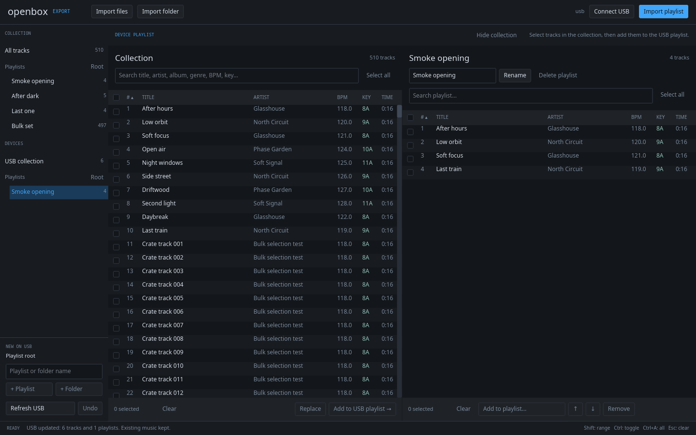
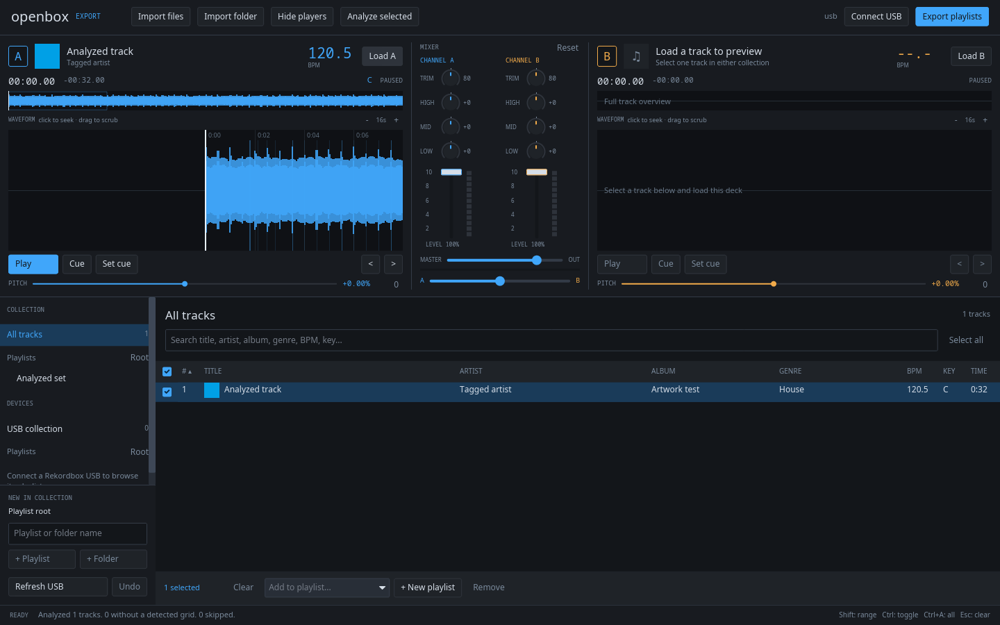
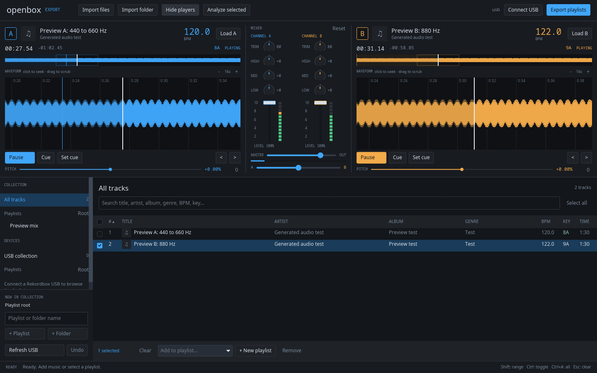

# Openbox

A native Rust and Iced application for preparing DJ collections and managing traditional Rekordbox USB libraries.





## Run

Requires Rust 1.89 or newer, FFmpeg with `libmp3lame`, `ffprobe`, a C++11 compiler, the FFTW3 runtime (`libfftw3-double3` on Debian/Ubuntu), and the usual Linux desktop libraries. Analysis engines build through Cargo; no additional command-line analyzer is required.

Building audio preview on Linux also requires ALSA development headers (`libasound2-dev` on Debian/Ubuntu) and `pkg-config`. Playback uses the desktop's default audio output, including PulseAudio/PipeWire through ALSA.

```sh
cargo run --release
```

The desktop feature is enabled by default. `cargo run` also works; rendering dependencies are optimized in development builds. Cargo manages the Rust dependencies.

For generated demo music:

```sh
node scripts/demo.mjs
cargo run --release -- --demo
```

Node is optional and only used by the demo generator and native smoke harness.

Startup options use Clap:

```sh
cargo run --release -- --help
cargo run --release -- --library /path/to/library.json --usb /run/media/your-name/DJUSB
```

## Prepare a playlist

Import a folder or multiple audio files. The collection and device trees stay visible together.

- Click a track to select it. Use **Shift-click** for a range, **Ctrl-click** to toggle tracks, or the checkboxes for individual additions to the selection.
- **Ctrl+A**, **Select all**, or the heading checkbox selects the entire filtered list, including tracks outside the visible viewport. **Esc** clears the selection.
- Search by title, artist, album, genre, BPM or key. Click a column heading to sort; click it again to reverse the sort. **#** restores playlist order. Changing a filter removes hidden tracks from the selection.
- Use **Add to playlist...** once to add the whole selection. Existing members are skipped and the displayed selection order is preserved.
- In the collection, **+ New playlist** creates a populated playlist from the selection and focuses its name for immediate editing.
- Select a playlist to remove or move selected tracks together. **Delete** removes the selection from that playlist. Up/down move selected blocks while preserving their internal order; these controls use the original playlist order and are disabled during filtering or other sorts.

The sidebar shows expandable playlist folders. Select a folder, enter a name, then choose **+ Playlist** or **+ Folder**. Selecting a playlist creates siblings in its parent folder. **Root** creates at the top level.

Local changes persist in `.prototype/library.json`, unless `--library` supplies another file. Existing flat libraries continue to load.

## Preview and mix



Click **Players** in the toolbar. Select one track in the collection or on the USB, then click **Load A** or **Load B**. Each song loads in the background without changing its source file.

- **Play/Pause** controls each deck independently. **Set cue** stores the current position and pauses; **Cue** returns to it. Cue points belong to the preview session.
- Click the full-track overview to jump anywhere. Click the scrolling waveform to seek, or drag it left/right to scrub. **+ / -** changes its visible time span from 4 to 64 seconds. The small **< / >** buttons move 50 ms for fine alignment.
- Use pitch within ±8% to match analyzed BPM values manually. Pitch changes speed and pitch together. **0** resets it; there is no key lock or automatic sync. Detected beat lines appear in the scrolling waveform.
- Each mixer channel has trim and EQ knobs above a vertical volume fader and a level meter. Drag knobs vertically or scroll to adjust; double-click or right-click to reset. Drag channel faders to mix levels; Ctrl-click resets them, and Shift gives fine adjustment. Meters show the signal before the fader, so you can watch a playing channel while its volume is down. The crossfader stays horizontal.
- The mixer has three-band EQ, channel level, master level, signal meters and an equal-power crossfader. **Reset** restores neutral EQ and default levels. The output is limited to prevent samples exceeding full scale; **CLIP** indicates excessive gain.
- Hiding the players keeps playback running while you organise music. Playback uses the desktop's default output. **Retry audio** reconnects after an output error.

Only the two selected songs are decoded, as shared stereo PCM with waveform envelopes. Preview supports files up to 30 minutes long. It has no separate headphone output, MIDI controls, recording or persistent performance cues.

## Manage a USB

Connect the root of a mounted FAT32 USB. Traditional Rekordbox libraries open directly from `PIONEER/rekordbox/export.pdb`.

- **Collection to USB:** select a local playlist or folder, then export it. Matching folder paths are updated while unrelated device playlists remain intact.
- **Add a batch to a device playlist:** select the USB playlist in the device tree. The collection opens beside it. Search or sort the collection, select any number of tracks, then click **Add to USB playlist →** once.
- **Replace a song:** select exactly one collection track and one USB playlist entry, then click **Replace**. The original device audio stays in the device collection.
- **Remove entries:** select a range or all entries in the USB playlist, then click **Remove** or press **Delete**. **Undo** restores the previous playlist contents.
- **Remove a playlist:** click **Delete playlist**. Audio remains on the USB, and **Undo** restores the playlist.
- **USB to collection:** select a USB playlist, then click **Import playlist**. Its audio is copied into local storage and its folder path is retained. Name collisions get a suffix.
- The collection's bulk action bar also offers **Send to USB playlist...** when a device playlist is available.

Export and batch transfer show a percentage bar in the bottom status section. Progress covers source checks, encoding within each song, waveform creation, file publication and database saving. It reaches 100% only after the resulting device library reopens successfully.

Use **Refresh USB** after changing the device through another application. Eject it through the desktop before unplugging.

## Device preservation and limits

Opening a USB is read-only. Writes back up the previous database under `.openbox/backups/`, take an exclusive writer lock, and reject a changed database snapshot. Playlist edits retain original audio, track records, analysis files, cues, beatgrids, folder relationships and unrelated tables. New audio is staged before publication. Ordinary failures clean up only files created by that transfer.

New collection audio is encoded as stereo 44.1 kHz, 320 kbps MP3 with DAT/EXT waveforms and detected beat entries. BPM and key are written into the device database and ID3 tags. Export compensates for MP3 priming delay so the grid follows the exported waveform. Existing USB audio, analysis and artwork remain byte for byte; unchanged transfers reuse their assets.

Imports automatically analyze BPM, beats and musical key using [aubio](https://aubio.org/) and [Mixxx libkeyfinder](https://github.com/mixxxdj/libkeyfinder). For existing collections, click **Analyze library**, or select a batch and click **Analyze selected**, then reexport the playlist. Analysis progress appears in the status bar. An export also analyzes legacy tracks that have no stored analysis. Silence or short clips may produce no grid; the import status reports that count. Automatic 4/4 bar numbering starts at the first detected beat and does not identify the musical downbeat. Tempo, key and phase remain estimates to check by ear before relying on player sync/quantize.

Lofty reads ID3 and other supported tags. Titles, artists, albums, genres, album artists, composers, comments, dates and track/disc numbers are retained; the browser and preview decks display cover artwork. USB export writes ID3v2.3 with an embedded JPEG and registers 80x80 and 240x240 artwork files. USB playlist import copies artwork, audio and the grid locally so they remain available after unplugging. Local cue editing and exporting imported cues to another device are not implemented.

The application does not format drives or delete existing USB audio. Backups and old database pages accumulate with edits. The writer is not journaled against power loss or sudden removal.

**The user has confirmed USB playlist visibility on their hardware. BPM, grid, artwork, sync/quantize and complete playback behavior still need physical XDJ-1000 validation.** File-format and GUI validation cannot prove player compatibility. See [the hardware checklist](docs/HARDWARE-VALIDATION.md).

## Workspace

| Crate | Responsibility |
|---|---|
| `openbox-domain` | Track identity, playlist trees, bulk membership and ordering rules |
| `openbox-storage` | JSON persistence, atomic writes and file fingerprints |
| `openbox-rekordbox` | Existing device databases, transfer staging, waveforms, backups and preservation |
| `openbox-library` | Application commands, import and save coordination |
| `openbox-analysis` | Streaming aubio beat/tempo analysis and Mixxx libkeyfinder key detection |
| `openbox-metadata` | Lofty tags, JPEG cover cache, device artwork and ID3 export |
| `openbox-audio` | Preview decoding, waveform envelopes, two-deck mixing and audio output |
| `openbox` | Iced desktop, browser selection/filter/sort/viewport state and Clap startup |
| `openbox-test-support` | Fixtures shared through dev dependencies only |

Adapters depend on the domain. Application operations use the adapters. The desktop calls those operations and performs transfers in background tasks. A bulk edit validates and persists once before publishing the new state.

Track rows are rendered only around the visible viewport. Selection remains based on track identities across the full filtered list. See [ADR 002](docs/adr/002-workspace-and-bulk-browser.md).

The device adapter uses [Bake'n Deck](https://github.com/M-Igashi/baken), pinned to revision `2789f0615236affdf65d856171b58dfd1eb2425d`. Independent format tests use [rekordcrate](https://github.com/Holzhaus/rekordcrate). See [ADR 004](docs/adr/004-analysis-and-artwork.md) and [third-party licensing notices](THIRD-PARTY-NOTICES.md) for the analysis dependencies. GPLv3 requirements apply when distributing the combined executable.

## Validate

```sh
cargo test --workspace --all-targets
cargo clippy --workspace --all-targets -- -D warnings
cargo fmt --all -- --check
cargo build --release
node scripts/demo.mjs
xvfb-run -a -s '-screen 0 1600x1100x24' node scripts/smoke.mjs
xvfb-run -a -s '-screen 0 1600x1100x24' node scripts/players-smoke.mjs
xvfb-run -a -s '-screen 0 1600x1100x24' node scripts/analysis-smoke.mjs
```

The native smoke harness uses the release executable, a 510-track collection, generated audio and a real Rekordbox database fixture in isolated temporary folders. It exercises keyboard selection, bulk edits, playlist creation from selection, scrolling, sorted batch USB transfer, replacement, deletion/Undo, nested trees and import. It checks original audio, analysis and database pages byte for byte. It requires Node.js, Xvfb, xdotool and ImageMagick. Set `OPENBOX_BIN=target/debug/openbox` to test a development executable.

The player harness also requires `pactl` and `parec`. It creates an isolated test output, records generated tones to verify the sound, and removes that output afterwards without changing the desktop's default sink.

For core crates without the desktop feature:

```sh
cargo test --workspace --no-default-features
```

The compiled executable is `target/release/openbox`. See [validation details](docs/VALIDATION.md).

## License

MIT. Third-party dependencies retain their own licenses.
