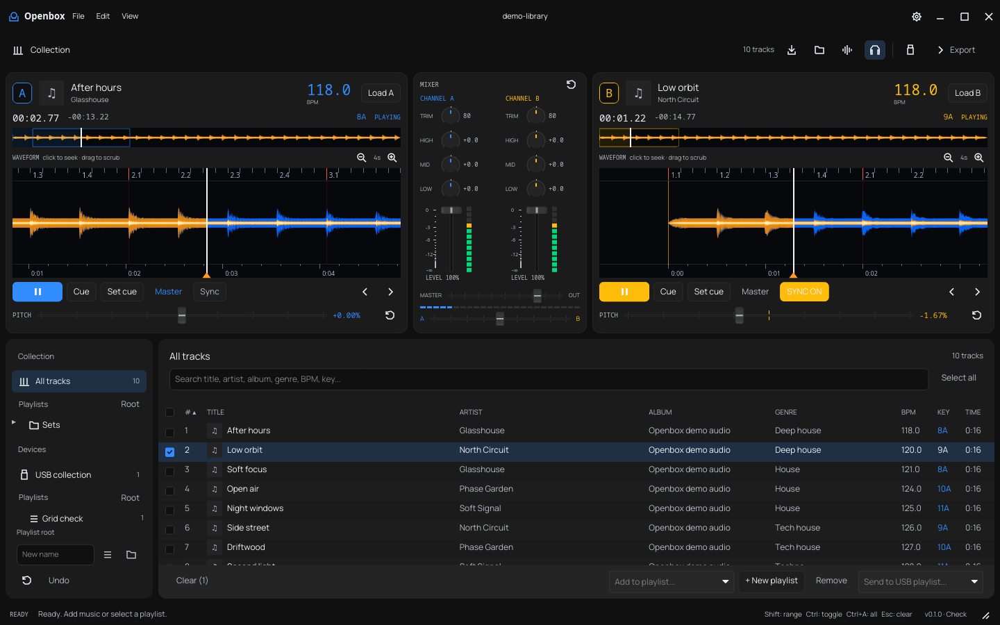
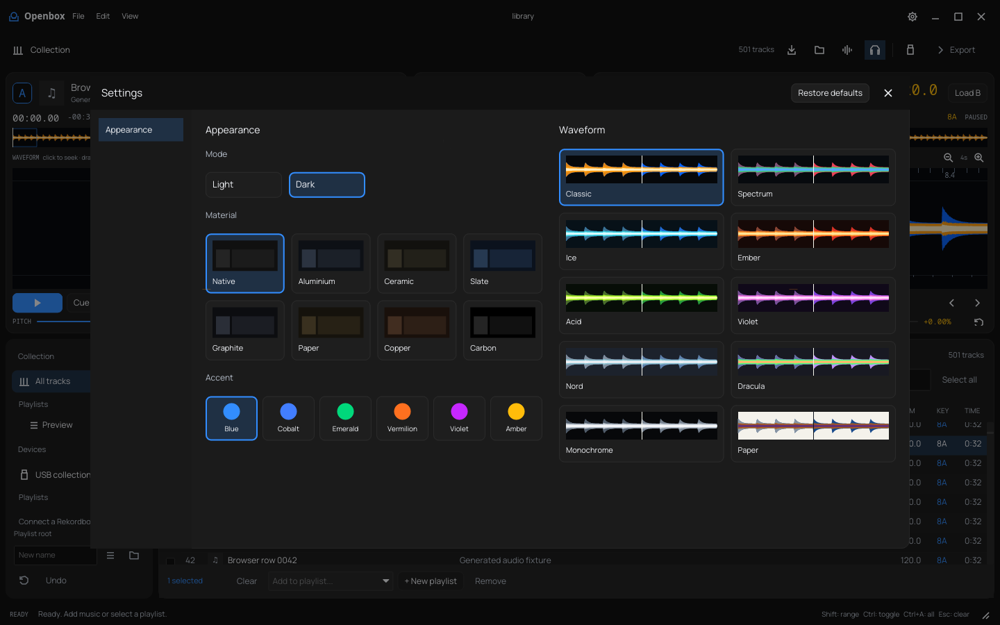
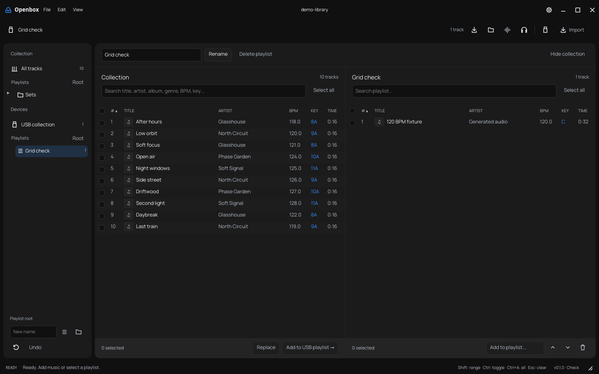

# Openbox

A native Rust and Iced application for preparing DJ collections on Linux, Windows and macOS.

- Search, sort and edit tracks in batches, with tags and cover artwork.
- Organise playlists in folders and move selections between local and USB libraries.
- Read existing Rekordbox USBs and export both Device Library and OneLibrary databases.
- Preview transitions with two decks, beat sync, EQ knobs and channel faders.
- Analyze BPM, key and beatgrids with aubio, libkeyfinder and Mixxx grid post-processing.
- Choose light or dark mode, materials, accents and waveform palettes.



## Installation

Get the archive for your platform from [Releases](https://github.com/alexanderwanyoike/openbox/releases) or the [project site](https://alexanderwanyoike.github.io/openbox/).

| Platform | Download |
|---|---|
| Linux, x86_64 | `openbox-x86_64-unknown-linux-gnu.tar.gz`, built on Ubuntu 24.04 |
| Windows, x86_64 | `openbox-x86_64-pc-windows-msvc.zip` |
| macOS, Apple silicon | `openbox-aarch64-apple-darwin.tar.gz` |
| macOS, Intel | `openbox-x86_64-apple-darwin.tar.gz` |

Install FFmpeg and ffprobe, including the `libmp3lame` encoder. On Ubuntu, use `sudo apt install ffmpeg`; on macOS, `brew install ffmpeg`. Windows users can install `Gyan.FFmpeg` with WinGet and restart Openbox after updating PATH. FFTW and the analysis engines are included in release builds. Release binaries are unsigned.

Extract the archive and run Openbox. On macOS, move `Openbox.app` to Applications. USBs must already be mounted; Openbox does not format them.

## Run

Source builds use Rust 1.96.1, FFmpeg with `libmp3lame`, `ffprobe` and a C++14 compiler. Linux development can use the FFTW3 system runtime (`libfftw3-double3` on Debian/Ubuntu). Native builds can instead set `OPENBOX_FFTW_SOURCE` to the FFTW 3.3.10 source directory and build it statically with CMake. Release builds use this source path. Analysis engines build through Cargo; no additional command-line analyzer is required.

macOS source builds also need Xcode command-line tools for Clang and libclang. Windows source builds use the Rust MSVC toolchain, Visual Studio's C++ build tools, CMake, Perl for vendored OpenSSL, and the FFTW source path above. See the [native workflow](.github/workflows/native.yml) for the exact dependencies and checksum-verified source preparation.

Building audio preview on Linux also requires ALSA development headers (`libasound2-dev` on Debian/Ubuntu) and `pkg-config`. Playback uses the desktop's default audio output, including PulseAudio/PipeWire through ALSA.

```sh
cargo run --release
```

The desktop and GPU renderer are enabled by default, with a software fallback. `cargo run` also works; rendering dependencies are optimized in development builds. Use `cargo run --no-default-features --features desktop` to build software rendering alone. Cargo manages the Rust dependencies.

For generated demo music:

```sh
node scripts/demo.mjs
cargo run --release -- --demo
```

Node is optional and only used by the demo generator and native smoke harness.

Startup options use Clap:

```sh
cargo run --release -- --help
cargo run --release -- --library /path/to/library.json --usb /run/media/your-name/DJUSB
```

## Prepare a playlist

Import a folder or multiple audio files. The collection and device trees stay visible together.

- Click a track to select it. Use **Shift-click** for a range, **Ctrl-click** to toggle tracks, or the checkboxes for individual additions to the selection.
- **Ctrl+A**, **Select all**, or the heading checkbox selects the entire filtered list, including tracks outside the visible viewport. **Esc** clears the selection.
- Search by title, artist, album, genre, BPM or key. Click a column heading to sort; click it again to reverse the sort. **#** restores playlist order. Changing a filter removes hidden tracks from the selection.
- Use **Add to playlist...** once to add the whole selection. Existing members are skipped and the displayed selection order is preserved.
- In the collection, **+ New playlist** creates a populated playlist from the selection and focuses its name for immediate editing.
- Select a playlist to remove or move selected tracks together. **Delete** removes the selection from that playlist. Up/down move selected blocks while preserving their internal order; these controls use the original playlist order and are disabled during filtering or other sorts.

The sidebar shows expandable playlist folders. Select a folder, enter a name in **New name**, then use the playlist or folder icon beside it. Tooltips identify each action. Selecting a playlist creates siblings in its parent folder. **Root** creates at the top level.

Local changes persist in the platform's application data directory, unless `--library` supplies another file:

| Platform | Default library |
|---|---|
| Linux | `$XDG_DATA_HOME/openbox/library.json`, or `~/.local/share/openbox/library.json` |
| macOS | `~/Library/Application Support/io.github.alexanderwanyoike.openbox/library.json` |
| Windows | `%LOCALAPPDATA%\alexanderwanyoike\openbox\data\library.json` |

Existing library files are not moved. To open a prototype collection, pass `--library /path/to/.prototype/library.json`. `--demo` retains its separate generated demo library. Existing flat libraries continue to load.

The app bar contains File, Edit and View menus. Import, analysis, deck visibility and USB actions are in the workspace toolbar below it. Drag the app caption to move the window; use its window buttons or the bottom-right resize grip.

## Preview and mix

Click **Players** in the toolbar. Select one track in the collection or on the USB, then click **Load A** or **Load B**. Each song loads in the background without changing its source file.

- **Play/Pause** controls each deck independently. **Set cue** stores the current position and pauses; **Cue** returns to it. Cue points belong to the preview session.
- Waveforms use layered frequency colors, finer detail, beat ticks and a fixed white playhead. Playback animates independently of the library browser.
- Click the full-track overview to jump anywhere. Click the scrolling waveform to seek, or drag it left/right to scrub. The zoom icons change its visible time span from 1 to 64 seconds. The small arrow icons move 50 ms for fine alignment.
- Use pitch within ±8% to match analyzed BPM values manually. Pitch changes speed and pitch together. The reset icon beside pitch returns it to zero; there is no key lock. Choose a **Master** deck and enable **Sync** on the other deck to match effective BPM and beat phase using their analyzed grids. Sync follows master pitch changes; manual follower pitch, seeking or cueing releases it. Rates must stay within ±8%. Sync aligns beats, not musical downbeats or phrases. Detected beat lines appear in the scrolling waveform.
- Each mixer channel has trim and EQ knobs above a vertical volume fader and a level meter. Drag knobs vertically or scroll to adjust; hold Shift for finer motion; double-click or right-click to reset. Drag channel faders to mix levels; Ctrl-click resets them, and Shift gives fine adjustment. Meters show the signal before the fader, so you can watch a playing channel while its volume is down. The crossfader stays horizontal.
- The mixer has three-band EQ, channel level, master level, signal meters and an equal-power crossfader. The mixer reset icon restores neutral EQ and default levels. The output is limited to prevent samples exceeding full scale; **CLIP** indicates excessive gain.
- Hiding the players keeps playback running while you organise music. Playback uses the desktop's default output. **Retry audio** reconnects after an output error.

Only the two selected songs are decoded, as shared stereo PCM with waveform envelopes. Preview supports files up to 30 minutes long. It has no separate headphone output, MIDI controls, recording or persistent performance cues.

## Appearance

Open Settings using the gear icon. Light and dark modes combine with eight materials and six saturated accents; Native uses Showbiz’s flat neutral surfaces. Ten waveform palettes are independent of the application theme. Choices persist beside the library in `library.settings.json`. Escape returns to the same browser position.



## Manage a USB



Connect the root of a mounted FAT32 USB. Traditional Device Library and OneLibrary devices open directly from `PIONEER/rekordbox/export.pdb` or `exportLibrary.db`. Exports write both formats.

- **Collection to USB:** select a local playlist or folder, then export it. Matching folder paths are updated while unrelated device playlists remain intact.
- **Add a batch to a device playlist:** select the USB playlist in the device tree. The collection opens beside it. Search or sort the collection, select any number of tracks, then click **Add to USB playlist →** once.
- **Replace a song:** select exactly one collection track and one USB playlist entry, then click **Replace**. The original device audio stays in the device collection.
- **Remove entries:** select a range or all entries in the USB playlist, then click **Remove** or press **Delete**. **Undo** restores the previous playlist contents.
- **Remove a playlist:** click **Delete playlist**. Audio remains on the USB, and **Undo** restores the playlist.
- **USB to collection:** select a USB playlist, then click **Import playlist**. Its audio is copied into local storage and its folder path is retained. Name collisions get a suffix.
- The collection's bulk action bar also offers **Send to USB playlist...** when a device playlist is available.

Export and batch transfer show a percentage bar in the bottom status section. Progress covers source checks, encoding within each song, waveform creation, file publication and database saving. It reaches 100% only after the resulting device library reopens successfully.

Use **Refresh** in the USB panel after changing the device through another application. Eject it through the desktop before unplugging.

## Device preservation and limits

Opening a USB is read-only. Writes back up the previous database under `.openbox/backups/`, take an exclusive writer lock, and reject a changed database snapshot. Playlist edits retain original audio, track records, analysis files, cues, beatgrids, folder relationships and unrelated tables. New audio is staged before publication. Ordinary failures clean up only files created by that transfer.

New collection audio is encoded as stereo 44.1 kHz, 320 kbps MP3 with DAT/EXT/2EX waveforms and detected beat entries. BPM and key are written into the device database and ID3 tags. Export compensates for MP3 priming delay so the grid follows the exported waveform. Existing USB audio, analysis and artwork remain byte for byte; unchanged transfers reuse complete prepared assets. Exports cached before modern waveform support are prepared again while retaining their previous device files.

Imports automatically analyze BPM and beats using [aubio](https://aubio.org/), with constant-tempo grid post-processing adapted from [Mixxx BeatUtils](https://github.com/mixxxdj/mixxx/blob/bc49961fd3e5a46cd46588090c652a0d7ec44e18/src/track/beatutils.cpp). [libkeyfinder](https://github.com/mixxxdj/libkeyfinder) detects musical key. For existing collections, click **Analyze** for the whole library, or select a batch first, then reexport the playlist. Analysis progress appears in the status bar. Export refreshes missing or outdated Openbox analysis without changing local records or imported Rekordbox grids. Silence or short clips may produce no grid; the import status reports that count. Automatic 4/4 bar numbering is a reference and does not identify the musical downbeat. Dynamic-tempo recordings, tempo, key and phase still need checking by ear before relying on player sync/quantize.

Lofty reads ID3 and other supported tags. Titles, artists, albums, genres, album artists, composers, comments, dates and track/disc numbers are retained; the browser and preview decks display cover artwork. USB export writes ID3v2.3 with an embedded JPEG and registers 80x80 and 240x240 artwork files. USB playlist import copies artwork, audio and the grid locally so they remain available after unplugging. Local cue editing and exporting imported cues to another device are not implemented.

The application does not format drives or delete existing USB audio. Backups and old database pages accumulate with edits. Interrupted saves are detected through a paired-file rollback journal. Use **Recover USB** in Devices to restore the previous library files. Opening a device never performs recovery automatically. Drive-controller or filesystem behaviour during power loss or unplugging is not guaranteed.

**The user has confirmed USB playlist visibility on their hardware. BPM, grid, artwork, sync/quantize and complete playback behavior still need physical XDJ-1000 validation.** File-format and GUI validation cannot prove player compatibility. See [the hardware checklist](docs/HARDWARE-VALIDATION.md).

Openbox writes the two library formats used by the requested player families. Traditional Device Library targets include CDJ-2000, CDJ-900/900NXS, CDJ-850, XDJ-1000/1000MK2 and CDJ-3000. OneLibrary targets include CDJ-3000X, OPUS-QUAD, OMNIS-DUO and XDJ-AZ. These are format targets, not a list of physically tested Openbox devices. Firmware can affect format selection; consult [AlphaTheta's compatibility notice](https://alphatheta.com/en/information/important-notice-for-customers-using-usb-devices-with-our-dj-equipment/) and [current USB export table](https://rekordbox.com/en/support/usb-export/).

## Workspace

| Crate | Responsibility |
|---|---|
| `openbox-domain` | Track identity, playlist trees, bulk membership and ordering rules |
| `openbox-storage` | JSON persistence, atomic writes and file fingerprints |
| `openbox-rekordbox` | Existing device databases, transfer staging, waveforms, backups and preservation |
| `openbox-library` | Application commands, import and save coordination |
| `openbox-analysis` | Streaming aubio beat/tempo analysis and Mixxx libkeyfinder key detection |
| `openbox-metadata` | Lofty tags, JPEG cover cache, device artwork and ID3 export |
| `openbox-audio` | Preview decoding, waveform envelopes, two-deck mixing and audio output |
| `openbox` | Iced desktop, browser selection/filter/sort/viewport state and Clap startup |
| `openbox-test-support` | Fixtures shared through dev dependencies only |

Adapters depend on the domain. Application operations use the adapters. The desktop calls those operations and performs transfers in background tasks. A bulk edit validates and persists once before publishing the new state.

Track rows are rendered only around the visible viewport. Selection remains based on track identities across the full filtered list. See [ADR 002](docs/adr/002-workspace-and-bulk-browser.md).

The device adapter uses [Bake'n Deck](https://github.com/M-Igashi/baken), pinned to revision `2789f0615236affdf65d856171b58dfd1eb2425d`. Independent format tests use [rekordcrate](https://github.com/Holzhaus/rekordcrate). See [waveform rendering decisions](docs/adr/005-waveform-rendering.md), [ADR 004](docs/adr/004-analysis-and-artwork.md) and [third-party licensing notices](THIRD-PARTY-NOTICES.md) for the analysis dependencies. GPLv3 requirements apply when distributing the combined executable.

## Validate

```sh
cargo test --workspace --all-targets
cargo clippy --workspace --all-targets -- -D warnings
cargo fmt --all -- --check
cargo build --release
node scripts/demo.mjs
xvfb-run -a -s '-screen 0 1600x1100x24' node scripts/smoke.mjs
xvfb-run -a -s '-screen 0 1600x1100x24' node scripts/settings-smoke.mjs
OPENBOX_CHECK_MOTION=1 node scripts/players-smoke.mjs
xvfb-run -a -s '-screen 0 1600x1100x24' node scripts/analysis-smoke.mjs
```

Workspace code also uses light optimization in development builds so `cargo run` keeps preview rendering responsive.

The native smoke harness uses the release executable, a 510-track collection, generated audio and a real Rekordbox database fixture in isolated temporary folders. It exercises keyboard selection, bulk edits, playlist creation from selection, scrolling, sorted batch USB transfer, replacement, deletion/Undo, nested trees and import. It checks original audio, analysis and database pages byte for byte. It requires Node.js, Xvfb, xdotool and ImageMagick. Set `OPENBOX_BIN=target/debug/openbox` to test a development executable.

The motion check requires FFmpeg and an accelerated X11 desktop. Xvfb provides software rendering for the functional checks. The player harness also requires `pactl` and `parec`. It creates an isolated test output, records generated tones to verify the sound, and removes that output afterwards without changing the desktop's default sink.

For core crates without the desktop feature:

```sh
cargo test --workspace --no-default-features
```

The compiled executable is `target/release/openbox`. See [validation details](docs/VALIDATION.md).

## License

Original Openbox source is MIT. The adapted Mixxx grid files are GPLv2 or later. GPLv3 terms apply to the combined executable because it links GPL components. Release packages include licensing notices and corresponding source; see [third-party notices](THIRD-PARTY-NOTICES.md).
